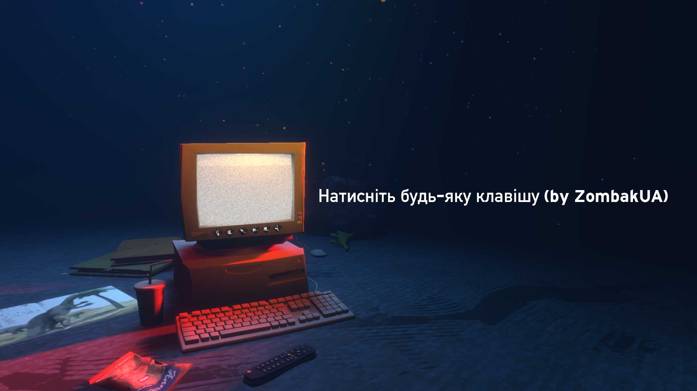
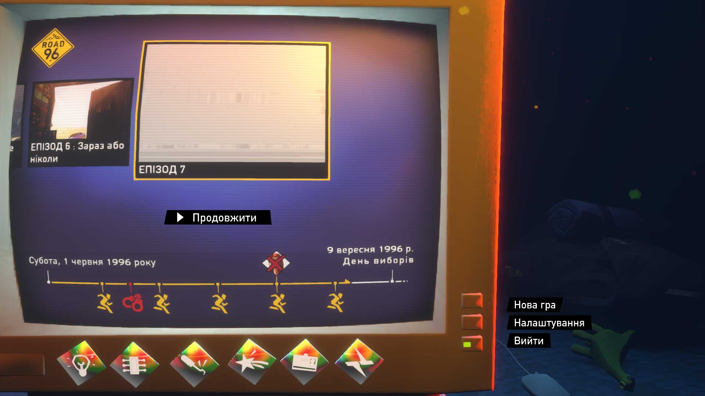
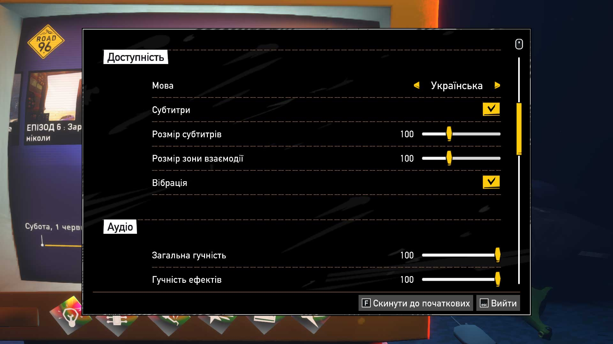

# Road 96

Повна текстова локалізація та український голосовий нейродубляж для сюжетної гри **«Road 96»**.

**Автор:** ZombakUA

---

## 📸 Скріншоти

---

## ✨ Особливості версії 4.0

* **Дефолтний слот (англійська):**
  * Українську мову інтегровано замість англійської (основної мови Steam).
  * Гра запускається українською мовою **одразу за замовчуванням** (не потрібно вручну перемикати в налаштуваннях).
  * У списку вибору мов слот підписано як **«Українська»**.
* **Текст та субтитри:**
  * 100% новий художній літературний переклад усіх діалогів, варіантів вибору, записок, підказок та екранів завантаження (понад 19 500 рядків) на базі Gemini LLM.
  * Виправлено всі ономатопеї (звукові реакції), русизми та кальки.
* **Голосовий дубляж:**
  * Повне голосове озвучення персонажів українською мовою (Алекс, Джон, Соня, Фанні, Джарод, Стен і Мітч, Зоя тощо).
  * Генерація через OmniVoice із нативним українським мовним кондиціонуванням (uk).
* **Шрифти:**
  * Оновлені текстурні атласи TextMeshPro SDF шрифтів.
  * Повна нативна підтримка всіх українських літер (**і, ї, є, ґ**, **І, Ї, Є, Ґ**) в інтерфейсі, діалогах та на екранах телевізора.

---

## 📥 Встановлення

1. Завантажте всі файли архіву з [релізу](https://github.com/zombaksteam/game-loc-road96/releases) в одну папку.
2. Розпакуйте архів в будь яке місце на вашому ПК.
3. Скопіюйте папку **Road 96_Data** у кореневу директорію гри Road 96 (туди, де знаходиться виконуваний файл Road 96.exe).
   * *За замовчуванням у Steam:* ...\SteamLibrary\steamapps\common\Road 963. Підтвердіть заміну файлів у вікні Windows (**«Замінити файли в папці призначення»**).
4. Запустіть гру через Steam — вона автоматично стартує українською мовою!

---

## 🔄 Видалення (повернення оригіналу)

У бібліотеці Steam:
1. Натисніть правою кнопкою миші на **Road 96** ➔ **Властивості** (*Properties*).
2. Перейдіть у вкладку **Встановлені файли** (*Installed Files*).
3. Натисніть **Перевірити цілісність файлів гри** (*Verify integrity of game files*).
Steam автоматично відновить оригінальні файли.
